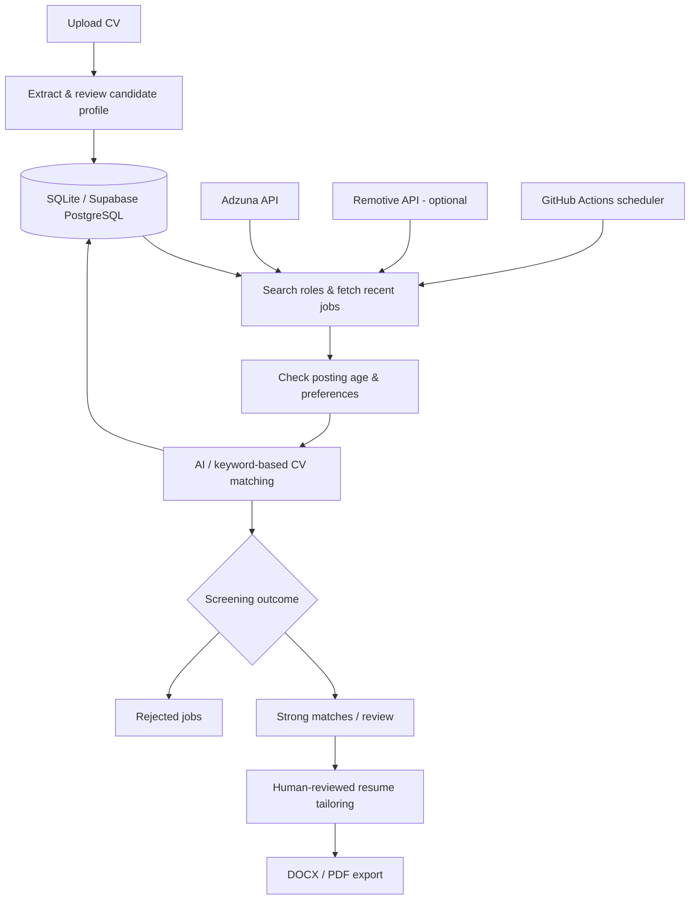

<div align="center">

# HireMeD

### AI-powered job discovery, candidate matching & ATS-friendly resume preparation

**Discover relevant opportunities. Understand the match. Prepare a stronger application.**

[](https://www.python.org/)
[](https://streamlit.io/)
[](.github/workflows/job_hunt.yml)
[](https://supabase.com/)

[](https://groq.com/)
[](https://ai.google.dev/)
[](https://developer.adzuna.com/)
[](https://remotive.com/)
[](#resume-tailoring)
[](#testing)

**[Features](#what-hiremed-does) · [How it works](#how-it-works) · [Quick start](#quick-start) · [Tech stack](#technology-stack) · [Deployment](#deployment--scheduled-discovery)**

</div>

---

## Overview

**HireMeD** is a Python-based job-search assistant that combines job APIs, large language models, configurable eligibility rules, and document generation in one Streamlit dashboard.

Instead of simply collecting vacancies, it uses a candidate's CV to suggest relevant roles, evaluate job descriptions, explain why opportunities are worth reviewing, and help prepare tailored resumes. A scheduled GitHub Actions workflow can run discovery without leaving the dashboard open.

The project demonstrates **API integration, AI-assisted decision support, structured data persistence, document processing, workflow automation, and human-in-the-loop design**. It is a job-search support tool—not an autonomous job-application service.

## What HireMeD does

| Capability | What it means |
| --- | --- |
| **CV analysis** | Upload a PDF, DOCX, or TXT CV and extract a structured, reviewable candidate profile. |
| **Job discovery** | Search Adzuna and optionally Remotive for recent opportunities; a sample CSV supports offline testing. |
| **AI-powered matching** | Compare demonstrated skills and experience with job descriptions and assign a relevance score from 0 to 100. |
| **Preference screening** | Check language, location, work arrangement, salary, and other stated requirements; reject explicitly incompatible jobs. |
| **Career agent** | Plan CV-grounded searches, investigate listings, record decisions, and summarize the latest run. |
| **Resume tailoring** | Prepare job-specific, ATS-friendly DOCX/PDF drafts from CV-supported facts, with a review step before download. |
| **Persistent history** | Store structured profiles, preferences, job assessments, and agent reports in SQLite or PostgreSQL. |
| **Scheduled discovery** | Use GitHub Actions to run the same discovery pipeline on a schedule or manually. |

### Understanding job labels

A **high CV match score is not the same as confirmed job eligibility**.

| Label | Meaning |
| --- | --- |
| **Strong match (80+)** | The CV appears highly relevant, and the job has not been explicitly rejected. The threshold is configurable. |
| **Verified eligible** | The available assessment and preference checks support eligibility; still verify details with the employer. |
| **Needs review** | Important details such as salary, language, or remote/hybrid arrangements are missing or uncertain. |
| **Rejected** | A known requirement conflicts with the candidate's saved preferences—for example, an explicitly mandatory Polish-language requirement for an English-only search. |
| **Submitted** | A job recorded as submitted in tracking; this does not mean HireMeD submitted an application automatically. |

The dashboard shows **Relevant jobs** by default and provides an **All (including rejected)** view for transparency. Explicitly rejected jobs are excluded from strong-match recommendations and automatic resume preparation.

## How it works



**Discovery:** Only listings with a usable timezone-aware posting date within the last seven days are included in new results. When both an original posting date and a repost date are available, the older date is used. This relies on source-provided dates; it cannot independently establish when an employer first advertised a role.

**Matching:** Groq is the primary AI provider, with Gemini as an optional fallback. Some workflows use conservative keyword-based fallbacks when AI is unavailable. Unknown requirements are flagged for review rather than treated as satisfied.

**Privacy:** The original CV is processed temporarily and is not saved to the shared database. Its structured profile is stored so later scheduled runs can use it.

## Technology stack

| Layer | Technologies | Role |
| --- | --- | --- |
| **Language & UI** | Python, Streamlit | Application logic and interactive dashboard |
| **AI** | Groq, Google Gemini | CV extraction, job evaluation, and assisted rewriting |
| **Job data** | Adzuna API, Remotive API | Live job discovery |
| **Database** | SQLite, PostgreSQL / Supabase | Profiles, preferences, job history, and reports |
| **Automation** | GitHub Actions | Daily and manually triggered discovery |
| **Documents** | `python-docx`, `pypdf`, ReportLab | CV extraction and DOCX/PDF generation |
| **Testing** | pytest | Automated checks for matching, persistence, and document workflows |

## Quick start

### 1. Install

**Requirements:** Python 3.11+ and pip. Use a virtual environment.

```bash
python -m venv .venv
```

Activate the environment:

```bash
# Windows (PowerShell)
.venv\Scripts\Activate.ps1

# macOS / Linux
source .venv/bin/activate
```

Install dependencies:

```bash
python -m pip install -r requirements.txt
```

### 2. Configure environment variables

Copy `.env.example` to `.env`, then enter your credentials. **Never commit `.env` or paste live credentials into issues.**

```dotenv
AI_PROVIDER=groq
AI_FALLBACK_PROVIDER=gemini
GROQ_API_KEY=your_groq_key
GEMINI_API_KEY=your_optional_gemini_key
ADZUNA_APP_ID=your_adzuna_app_id
ADZUNA_APP_KEY=your_adzuna_app_key
JOB_SOURCES=adzuna,remotive

# Optional for local-only use; required for shared cloud/scheduled state
DATABASE_URL=

# Local dashboard only; enable authentication when deployed publicly
HIREMED_REQUIRE_AUTH=false
```

`JOB_SOURCES=adzuna` uses Adzuna only; `adzuna,remotive` enables both sources. Remotive requires no API key. Its listings should retain their source attribution and link back to Remotive.

### 3. Launch the dashboard

```bash
python -m streamlit run dashboard.py --server.address 127.0.0.1
```

Open the URL printed in your terminal. Upload your CV, select **Analyze CV and update profile**, review the extracted details, and use **Search jobs now** or **Run career agent**.

### 4. Optional: run discovery from the command line

```bash
python -m dotenv run -- python job_bot.py
```

For an offline demonstration without live job APIs:

```bash
python -m dotenv run -- python job_bot.py --jobs-csv examples/jobs.csv
```

A saved structured CV profile is required before discovery can run. The command-line entry point currently expects Adzuna credentials for live searches, even when Remotive is enabled.

## Resume tailoring

HireMeD can prepare a job-specific CV package for sufficiently strong, non-rejected matches. The workflow is intentionally **human-reviewed**:

1. Upload the original CV in the current dashboard session.
2. Discover a suitable recent job and inspect its requirements.
3. Review proposed wording changes against the original CV.
4. Approve the draft and download the DOCX or PDF.
5. Apply manually through the employer's official application page.

The system aims to preserve factual experience, qualifications, numbers, and available portfolio URLs. Detected GitHub, LinkedIn, and other CV hyperlinks can be retained as clickable links in generated documents. AI edits are checked conservatively, but **neither factual accuracy nor ATS compatibility is guaranteed**; always inspect the exported file.

## Deployment & scheduled discovery

### Streamlit Community Cloud

Deploy `dashboard.py` as the app entry point. Add credentials using **App settings → Secrets** in TOML format, for example:

```toml
AI_PROVIDER = "groq"
AI_FALLBACK_PROVIDER = "gemini"
GROQ_API_KEY = "your_groq_key"
GEMINI_API_KEY = "your_optional_gemini_key"
ADZUNA_APP_ID = "your_adzuna_app_id"
ADZUNA_APP_KEY = "your_adzuna_app_key"
JOB_SOURCES = "adzuna,remotive"
DATABASE_URL = "your_supabase_postgresql_connection_uri"
HIREMED_REQUIRE_AUTH = "true"
HIREMED_DASHBOARD_PASSWORD = "a_strong_unique_password"
```

Do not use password-free mode for a publicly accessible dashboard. Protect the database and credentials and use HTTPS for hosted access.

### GitHub Actions

The [scheduled discovery workflow](.github/workflows/job_hunt.yml) runs at **07:00 UTC daily** and also supports manual execution through **Actions → HireMeD Scheduled Discovery → Run workflow**.

Configure the required credentials in GitHub Actions secrets: `DATABASE_URL`, `GROQ_API_KEY`, `ADZUNA_APP_ID`, `ADZUNA_APP_KEY`, and optionally `GEMINI_API_KEY`. If using **environment secrets**, the workflow job must reference the correct GitHub environment; repository secrets do not require this binding.

**Important:** Streamlit Cloud and GitHub Actions must use the **same `DATABASE_URL`** to share the saved profile, preferences, and job results. A local SQLite database is not shared with GitHub-hosted runners. Upload and analyze a CV *after* configuring the shared database.

For database connection instructions, see [SUPABASE_SETUP.md](SUPABASE_SETUP.md).

## Project structure

```text
HireMeD/
├── dashboard.py                  # Streamlit interface
├── job_bot.py                    # Scheduled / CLI entry point
├── hiremed/
│   ├── agent.py                  # Search planning and agent reports
│   ├── ai_provider.py            # Groq / Gemini integration
│   ├── core.py                   # CV parsing, job sources, matching
│   ├── discovery.py              # Shared discovery pipeline
│   ├── preferences.py            # Eligibility rules
│   ├── repository.py             # Job persistence
│   ├── storage.py                # Profile storage
│   ├── ats_tailoring.py          # Evidence-aware CV rewrites
│   └── resume_optimizer.py       # Resume preparation
├── .github/workflows/job_hunt.yml
├── examples/jobs.csv             # Offline sample data
├── tests/                        # Automated tests
├── .env.example                  # Configuration template
└── SUPABASE_SETUP.md             # Shared database setup
```

## Testing

```bash
python -m pytest -q
```

Automated tests cover important local behavior, but do **not** prove that live AI providers, job APIs, or a deployed Supabase instance are available. External integrations should also be verified in the target environment.

## Responsible use & limitations

- **No unattended job applications.** The dashboard and scheduled discovery do not automatically submit applications. A separate, legacy local browser helper exists but is not part of the shared PostgreSQL workflow.
- **Not every listing is complete.** Salary, language, work arrangement, and location may be missing or ambiguous. Such jobs require manual review.
- **Language screening is evidence-based.** Explicit incompatible language requirements can trigger rejection; absence of a requirement does not prove an English-only role.
- **Job coverage depends on source APIs.** Remotive is remote-focused, and some positions have geographic restrictions. Direct LinkedIn, Indeed, and Pracuj.pl integrations are not included.
- **CV content is sensitive.** Processing with configured cloud AI providers sends relevant CV or job content to those providers. Structured profile and assessment data remain in your configured database until removed.
- **Generated CVs require approval.** Review job links, factual claims, formatting, and eligibility before applying.

---

<div align="center">

**HireMeD — built to make job discovery more relevant, transparent, and manageable.**

*AI-assisted research and resume preparation. Human decisions remain in control.*

</div>
